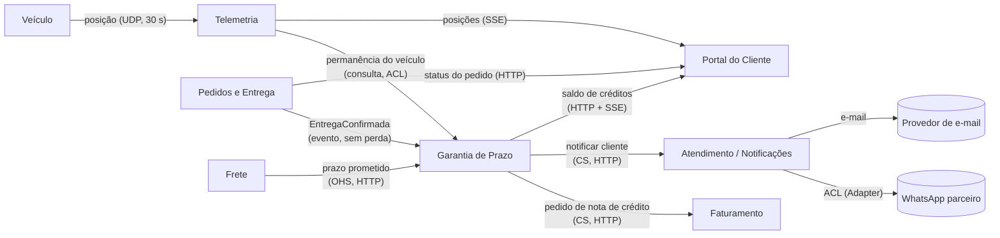

# 1. Modelagem do domínio

A Garantia de Prazo nasce como um **contexto novo** (Garantia de Prazo). Ele não é
colocado dentro de Pedidos nem de Faturamento, porque a regra de crédito muda por
decisão comercial (tipos de cliente, faixas, tetos) e esse ritmo de mudança é diferente
do ritmo de Pedidos (ciclo de vida do pedido) e de Faturamento (obrigação fiscal).

## Bounded contexts

O RNF01 foi decomposto em duas metades para que cada uma tenha um único dono:
**RNF01a** (a telemetria chega a cada 30 s e tolera perda) e **RNF01b** (a confirmação de
entrega não tolera perda).

| Contexto | Responsabilidade | Requisitos sob sua responsabilidade |
|---|---|---|
| **Garantia de Prazo** (novo) | Calcular o atraso, decidir se há direito a crédito (tipo de cliente, faixas, teto, ausência comprovada), garantir um único crédito por entrega e orquestrar a emissão da nota e a notificação | RF01, RF02, RF03, RF04, RF05, RF09, RNF02 |
| **Faturamento** (existente, C#) | Emitir a nota de crédito com número sequencial e único | RF06, RNF03 |
| **Atendimento / Notificações** (existente, Node/TS) | Entregar mensagens ao cliente pelo canal preferido, com retentativa e registro da falha final | RF07, RF08 |
| **Pedidos e Entrega** (existente, Java) | Dono do pedido e da **confirmação de entrega**; publica o fato "entrega confirmada" sem perda | RNF01b |
| **Telemetria** (existente, Python/Node) | Receber posições dos veículos, tolerando perda, e expor posição atual e histórico | RNF01a |
| **Acompanhamento (Portal do Cliente)** (existente, React) | Mostrar posição, previsão de chegada e saldo de créditos, ao vivo | RF10 |
| **Plataforma** (infraestrutura) | Empacotar e orquestrar todos os serviços | RNF04 |

Fornecedores de dado que **não são donos de requisito novo**: o serviço de **Frete**
(Python) continua dono do *prazo prometido*, e a telemetria continua dona da *posição*.
A Garantia de Prazo apenas consome esses dados (RF01 e RF05 usam o dado, mas a regra de
decisão é da Garantia).

### Por que RF05 é da Garantia e não da Telemetria

A Telemetria sabe **onde o veículo esteve**. Ela não sabe o que "ausência comprovada"
significa para o negócio (200 m, 10 min, antes do registro). Essa definição é uma regra de
elegibilidade ao crédito, e por isso mora na Garantia. A Telemetria só responde a uma
pergunta de fato: "onde o veículo X esteve entre T1 e T2".

## Mapa de contexto

Relações: **CS** = cliente/fornecedor (quem consome pede, quem fornece atende),
**ACL** = camada anticorrupção (tradução na fronteira), **OHS** = serviço aberto com
linguagem publicada.

Leitura das direções:

- **Pedidos e Entrega, Frete e Telemetria são upstream da Garantia.** A Garantia só consome.
  Nenhum deles passa a conhecer regra de crédito.
- **Garantia é upstream de Faturamento e de Notificações** (ela manda; eles executam).
  Faturamento e Notificações não conhecem "garantia", só "nota de crédito" e "mensagem".
- **O Portal é consumidor final** de três fontes, e nunca escreve em nenhuma.
- Cada contexto mantém o **seu schema** no PostgreSQL, e ninguém lê a tabela do outro
  (mesma regra da ADR-006).

## Entidades e agregados

| Agregado | Raiz | Entidades e objetos de valor | Regra que protege |
|---|---|---|---|
| **Crédito de Garantia** (Garantia de Prazo) | `CreditoDeGarantia` | VO `Atraso` (duração), VO `Dinheiro` (valor e moeda), VO `PrazoPrometido` (instante, vindo do Frete), VO `TipoDeCliente`, VO `ChaveDeEntrega` (identifica a confirmação), entidade `Decisao` (concedido, sem direito, negado por ausência) | Existe **no máximo um** crédito por entrega (`ChaveDeEntrega` única). O valor nunca ultrapassa o teto do tipo de cliente. Depois de emitido, é imutável |
| **Nota de Crédito** (Faturamento) | `NotaDeCredito` | VO `NumeroDaNota`, VO `Dinheiro`, referência ao crédito de origem | Número único e sequencial, mesmo sob concorrência. Uma nota por crédito de origem |
| **Pedido** (Pedidos e Entrega) | `Pedido` | `ConfirmacaoDeEntrega` (instante, id), VO `Endereco`, VO `StatusPedido` | A entrega é confirmada uma única vez. Pedido entregue não muda de endereço |
| **Notificação** (Atendimento) | `Notificacao` | VO `Canal` (e-mail, WhatsApp), entidade `Tentativa`, VO `EstadoDeEnvio` (pendente, enviada, falha final) | No máximo 1 tentativa inicial e 3 retentativas. Falha final fica **registrada e visível**, nunca descartada |
| **Trajeto** (Telemetria) | `PosicaoDoVeiculo` | VO `Coordenada`, VO `Instante` | Posição é fato imutável. Não há garantia de entrega (perda tolerada) |
| **Promessa de Prazo** (Frete) | `CotacaoDeFrete` | VO `PrazoPrometido`, VO `Dinheiro` (valor do frete) | O prazo prometido fica gravado na cotação e não muda depois |

Decisão de modelagem: o **valor do frete e o tipo de cliente são copiados** (snapshot) para
o `CreditoDeGarantia` no momento do cálculo. Assim o crédito não muda se o cadastro do
cliente mudar depois, e a Garantia não depende de Pedidos estar no ar para ser auditada.

## Linguagem ubíqua

| Termo | Definição |
|---|---|
| **Prazo prometido** | Instante limite de entrega prometido ao cliente pelo serviço de Frete no momento da cotação |
| **Confirmação de entrega** | Fato registrado por Pedidos e Entrega de que a mercadoria foi entregue, com o instante em que ocorreu |
| **Atraso** | Tempo decorrido entre o prazo prometido e a confirmação de entrega, medido em horas. Se a entrega ocorre antes do prazo, o atraso é zero |
| **Tolerância** | Os primeiros 120 minutos de atraso (até 2 h inclusive), que não geram crédito |
| **Faixa de atraso** | Intervalo de atraso associado a um percentual do frete (até 2 h, mais de 2 h até 24 h, mais de 24 h até 72 h, mais de 72 h). Os limites superiores são **inclusivos** |
| **Frete** | Valor cobrado pelo transporte do pedido. É a **base de cálculo** do crédito (não o valor da mercadoria) |
| **Tipo de cliente** | Classificação comercial que define a política de crédito: Varejo, Corporativo, Cortesia (e outros que vierem) |
| **Cortesia** | Cliente cujo frete é zero. Não recebe crédito, mas é notificado do atraso |
| **Crédito** | Valor em reais concedido ao cliente por atraso, calculado como percentual do frete e limitado pelo teto |
| **Teto** | Valor máximo de crédito **por pedido**, definido por tipo de cliente (Varejo R$ 500, Corporativo R$ 2.000) |
| **Ausência comprovada** | Situação em que a telemetria mostra o veículo parado a até 200 m do endereço por pelo menos 10 min antes do registro de ausência do destinatário. Elimina o direito ao crédito |
| **Permanência** | Intervalo contínuo em que o veículo ficou dentro do raio de 200 m do endereço |
| **Nota de crédito** | Documento emitido pelo Faturamento que formaliza o crédito. Tem **número sequencial único**. Não é sinônimo de "crédito" |
| **Saldo de créditos** | Soma dos créditos concedidos ao cliente e ainda não utilizados |
| **Canal preferido** | Meio escolhido pelo cliente para ser avisado: e-mail ou WhatsApp |
| **Falha final** | Estado de uma notificação que esgotou as retentativas sem sucesso. Deve ficar registrada e visível para a operação |
| **Chave de entrega** | Identificador da confirmação de entrega, usado para reconhecer a mesma confirmação recebida duas vezes |
| **Confirmação duplicada** | A mesma confirmação de entrega recebida mais de uma vez (reenvio, retentativa de rede). Gera no máximo um crédito |

Atenção ao vocabulário: "entrega" (o fato de entregar), "confirmação de entrega" (o registro
do fato) e "crédito" (valor) são termos distintos. "Nota de crédito" é o documento. O código
não pode usar um pelo outro.
