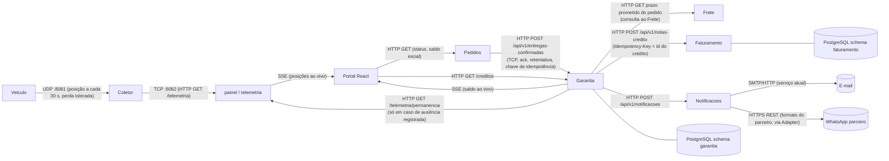

# 2. Arquitetura

Serviço novo: **`garantia`** (Python, FastAPI, porta 8020), seguindo o contrato de nomes,
portas e variáveis `LOGITECH_*` das ADRs da plataforma. Ele tem `GET /health` aberta, CORS
lido de `LOGITECH_CORS_ORIGINS` (o Portal é um navegador) e schema próprio `garantia` no
PostgreSQL.

## Diagrama dos serviços



## Protocolo de cada comunicação

| Origem | Destino | Protocolo | Requisito atendido | Justificativa |
|---|---|---|---|---|
| Veículo | Coletor (telemetria) | **UDP** | RNF01a | Posição a cada 30 s. A posição de 30 s atrás não interessa mais: o que vale é a frescura. Sem handshake, sem retransmissão. A perda de pacotes é tolerada pelo requisito, então TCP só acrescentaria latência e overhead (mesmo argumento do GPS na Aula 01) |
| Coletor | Painel | **TCP/HTTP** (`GET /telemetria`, porta 8082) | RNF01a | Comunicação interna entre serviços, já existente. Leitura sob demanda, e TCP entrega ordenado |
| Painel | Portal | **SSE** (HTTP, `text/event-stream`) | RF10 | O fluxo é só do servidor para o navegador, sem mensagem de volta. SSE é HTTP puro, reconecta sozinho e não precisa do protocolo extra do WebSocket (decisão da Aula 02) |
| Pedidos | Garantia | **HTTP/TCP** com confirmação (`200`/`409` idempotente), retentativa com a mesma chave | RNF01b, RF09 | A confirmação de entrega **não tolera perda**, então não pode ir por UDP. TCP garante entrega e ordem, e a resposta HTTP serve de confirmação. Se a resposta se perder, Pedidos reenvia: por isso a Garantia precisa ser idempotente (RF09) |
| Garantia | Frete | **HTTP/TCP** (`GET`), resultado gravado (snapshot) na criação do pedido | RF01 | O prazo prometido é dado do Frete. A Garantia o grava (snapshot) junto ao pedido, para não depender do Frete no momento do cálculo |
| Garantia | Painel/Telemetria | **HTTP/TCP** (`GET`) | RF05 | Consulta pontual e rara (só quando há ausência registrada). Precisa de resposta confiável, não de fluxo |
| Garantia | Faturamento | **HTTP/TCP** (`POST`, cabeçalho `Idempotency-Key`) | RF06, RNF02 | Emissão de nota é operação de escrita que não pode se perder nem duplicar. A chave de idempotência torna a retentativa segura |
| Garantia | Notificações | **HTTP/TCP** (`POST /api/v1/notificacoes`, contrato existente `{canal, destinatario, mensagem}`) | RF07 | Reuso do contrato já publicado. `canal` passa a aceitar `whatsapp` |
| Notificações | Provedor de e-mail | **SMTP/HTTP** (atual) | RF07 | Integração existente, não muda |
| Notificações | WhatsApp parceiro | **HTTPS/REST** (formato do parceiro) | RF07, RF08 | API externa com formato diferente: a diferença fica isolada num **Adapter** |
| Garantia | Portal | **SSE** (saldo) + `GET` (saldo inicial) | RF10 | Saldo muda poucas vezes e só do servidor para o cliente: mesmo raciocínio do SSE da posição. O `GET` entrega o estado inicial, e o SSE as mudanças |
| Portal | Pedidos / Garantia | **HTTP/TCP** (`GET`), com CORS | RF10 | O consumidor é o navegador, que aplica a política de mesma origem. `LOGITECH_CORS_ORIGINS` precisa incluir `http://localhost:5173` |

**Observação sobre HTTP/2.** O navegador limita a ~6 conexões por origem em HTTP/1.1, e cada SSE
ocupa uma. Com dois fluxos SSE por aba (posição e saldo), servir sobre HTTP/2 (multiplexação) evita
esgotar o limite com várias abas abertas.

## Padrões de projeto

| Ponto da solução | Padrão | Requisito | Justificativa |
|---|---|---|---|
| Cálculo do crédito por tipo de cliente (Varejo, Corporativo, Cortesia, futuros) | **Strategy** (`PoliticaDeCredito`) mais um **registro** de políticas por tipo | RF02, RF03, RF04 | Cada tipo é uma classe com seu multiplicador e teto. Um tipo novo é uma classe nova e uma linha no registro, **sem editar** as políticas existentes (Aberto/Fechado). O registro faz o papel de fábrica simples, e o que ele devolve é uma Strategy executada a cada cálculo |
| Envio de WhatsApp pelo parceiro | **Adapter** (`AdaptadorWhatsAppParceiro` implementa `CanalDeNotificacao`) | RF07 | O parceiro tem payload e autenticação diferentes. O Adapter traduz `{canal, destinatario, mensagem}` para o formato dele, e só um arquivo conhece o vocabulário do parceiro. Se o parceiro mudar o formato, muda um arquivo |
| Retentativa e registro de falha do envio | **Decorator** (`ComRetentativa` por fora de `ComLog`) sobre qualquer `CanalDeNotificacao` | RF08 | Retentativa (1 tentativa + até 3 retentativas) e log valem para e-mail e WhatsApp, então não pertencem a canal nenhum. Embrulhar por fora não altera o enviador homologado. A ordem (retentativa por fora) faz cada tentativa aparecer no log |
| Persistência do crédito e da nota | **Repository** (`CreditoRepository`, `NotaDeCreditoRepository`) com Inversão de Dependência | RF09, RF06 | A regra de negócio depende de uma interface declarada no domínio. Permite testar a regra com dublê em memória e concentrar a restrição de unicidade na implementação com PostgreSQL |
| Consulta ao prazo prometido e à permanência do veículo | **Adapter / Anti-Corruption Layer** (`ClienteDeFrete`, `ClienteDeTelemetria`) | RF01, RF05 | A Garantia fala a linguagem dela (`PrazoPrometido`, `Permanencia`) e traduz na fronteira, sem vazar `COD_`/campos dos outros serviços para dentro da regra |

### Ponto onde a dupla decidiu não aplicar padrão

**Numerador de nota de crédito: não usar Singleton.** Na Aula 05 o `NumeradorNotaFiscal` foi um
Singleton thread-safe (`Lazy` mais `lock`), e o padrão parece cabível aqui. Mas aquele Singleton
protege **um processo**: o `lock` só serializa threads da mesma instância. Com mais de uma
réplica do Faturamento (RNF04 sobe vários contêineres), cada réplica teria o seu contador e dois
números iguais sairiam, ou o contador voltaria a zero a cada reinício (defeito já visto na Aula 07).
A unicidade precisa ser garantida **onde o dado mora**: uma `SEQUENCE` do PostgreSQL e um índice
único. Portanto: sem Singleton, a garantia sai do banco.

Outros lugares onde o padrão foi avaliado e **não** aplicado:

- **Strategy para o cálculo das faixas de atraso.** As quatro faixas são dados de uma tabela
  (limite, percentual), não algoritmos diferentes. Uma lista ordenada resolve, e uma classe por
  faixa seria cerimônia (critério da Aula 06: "os ramos são de uma linha"). O Strategy fica só
  na dimensão que varia por cliente.
- **Facade sobre Faturamento e Notificações.** Só há dois destinos, com contratos diferentes, e
  chamados em momentos diferentes. Uma fachada não esconderia complexidade nenhuma.

## Confirmação de entrega duplicada (RF09)

**Onde fica a garantia: no banco de dados do contexto Garantia, na restrição de unicidade.**
A checagem "já processei?" feita só no código tem corrida (duas requisições simultâneas passam
ambas). A garantia real é:

1. Pedidos envia a confirmação com a **chave de entrega** (`confirmacao_id`, estável: derivada do
   pedido e do instante da confirmação). Um reenvio carrega a **mesma** chave.
2. A tabela `garantia.creditos` tem `UNIQUE (chave_de_entrega)`. O processamento faz, em **uma
   transação**: `INSERT ... ON CONFLICT (chave_de_entrega) DO NOTHING RETURNING id`.
3. Se o `INSERT` retornou linha, esta chamada é a **vencedora**: calcula e segue o fluxo
   (nota e notificação). Se não retornou, é duplicata: a Garantia devolve `200` com o crédito
   já existente e **não** chama Faturamento nem Notificações de novo.
4. Duas duplicatas **simultâneas** são serializadas pelo índice único: só uma insere.
5. A chamada ao Faturamento leva `Idempotency-Key = id do crédito`, e a tabela de notas tem
   índice único em `credito_origem_id`. Assim, se a Garantia cair entre gravar o crédito e emitir
   a nota, a retomada (status `PENDENTE_NOTA`) pode repetir a chamada sem emitir nota duas vezes.

Teste que prova: CT18 (duplicata sequencial) e CT19 (duplicatas concorrentes) no plano de testes

## Numeração das notas de crédito (RF06 e RNF03)

- O número vem de uma **`SEQUENCE`** do PostgreSQL (`faturamento.seq_nota_credito`), obtida com
  `nextval` no mesmo `INSERT` da nota. `nextval` é atômico entre conexões, então 1.000 emissões
  concorrentes recebem 1.000 valores distintos, mesmo com várias réplicas do Faturamento.
- Índice `UNIQUE` em `numero` como segunda barreira: se um defeito de código gerar número repetido,
  o banco recusa em vez de aceitar.
- Formato `NC-000001`, derivado do valor da sequência.
- **Ressalva (ver dúvida de negócio):** uma sequência garante unicidade e ordem crescente, mas
  **pode deixar buracos** se uma transação for desfeita depois do `nextval`. Se a exigência fiscal
  for numeração sem buracos, troca-se por uma linha de contador com `SELECT ... FOR UPDATE`, que
  serializa as emissões (mais lenta, ainda dentro do RNF02).
Prova: CT20 dispara 1.000 emissões concorrentes e confere 1.000 números distintos

## Execução em contêineres (RNF04)

Um único comando: `docker compose up -d --build --wait`. Rede `logitech-net` e volume de
telemetria são externos (criados na Aula 03). O healthcheck usa `127.0.0.1`, e não `localhost`
(armadilha do Alpine com IPv6 vista na Aula 07). `depends_on` usa `condition: service_healthy`,
porque a forma curta não espera prontidão.

```yaml
name: logitech

x-saude: &saude
  interval: 10s
  timeout: 4s
  retries: 6
  start_period: 25s

services:
  postgres:
    image: pgvector/pgvector:pg16        # mesma imagem da plataforma; não publica porta
    environment:
      POSTGRES_DB: logitech
      POSTGRES_USER: logitech
      POSTGRES_PASSWORD: ${LOGITECH_DB_PASSWORD:?copie .env.exemplo para .env}
    volumes: [logitech-postgres:/var/lib/postgresql/data]
    networks: [logitech-net]
    mem_limit: 256m
    healthcheck:
      <<: *saude
      test: ["CMD-SHELL", "pg_isready -U logitech -d logitech"]

  coletor:
    build: ./servicos/coletor
    ports: ["8081:8081/udp", "8082:8082"]      # UDP da frota; TCP para o painel
    volumes: [logitech-telemetria:/dados]
    networks: [logitech-net]
    mem_limit: 96m
    healthcheck: { <<: *saude, test: ["CMD", "wget", "-q", "-O", "/dev/null", "http://127.0.0.1:8082/telemetria"] }

  painel:
    build: ./servicos/painel
    ports: ["3000:3000"]
    environment:
      LOGITECH_TELEMETRIA_URL: http://coletor:8082
      LOGITECH_CORS_ORIGINS: http://localhost:5173
    depends_on:
      coletor: { condition: service_healthy }
    networks: [logitech-net]
    mem_limit: 128m
    healthcheck: { <<: *saude, test: ["CMD", "wget", "-q", "-O", "/dev/null", "http://127.0.0.1:3000/health"] }

  frete:
    build: ./servicos/frete
    ports: ["8000:8000"]
    networks: [logitech-net]
    mem_limit: 128m
    healthcheck: { <<: *saude, test: ["CMD", "wget", "-q", "-O", "/dev/null", "http://127.0.0.1:8000/health"] }

  pedidos:
    build: ./servicos/pedidos
    ports: ["8080:8080"]
    environment:
      LOGITECH_DB_URL: jdbc:postgresql://postgres:5432/logitech
      LOGITECH_GARANTIA_URL: http://garantia:8020      # destino da EntregaConfirmada
      LOGITECH_FATURAMENTO_URL: http://faturamento:5080
      LOGITECH_CORS_ORIGINS: http://localhost:5173
    depends_on:
      postgres: { condition: service_healthy }
    networks: [logitech-net]
    mem_limit: 384m
    healthcheck: { <<: *saude, test: ["CMD", "wget", "-q", "-O", "/dev/null", "http://127.0.0.1:8080/health"] }

  faturamento:
    build: ./servicos/faturamento
    ports: ["5080:5080"]
    environment:
      LOGITECH_DB_URL: Host=postgres;Database=logitech
    depends_on:
      postgres: { condition: service_healthy }
    networks: [logitech-net]
    mem_limit: 256m
    healthcheck: { <<: *saude, test: ["CMD", "wget", "-q", "-O", "/dev/null", "http://127.0.0.1:5080/health"] }

  notificacoes:
    build: ./servicos/notificacoes
    ports: ["3001:3001"]
    environment:
      LOGITECH_WHATSAPP_PARCEIRO_URL: ${LOGITECH_WHATSAPP_PARCEIRO_URL:-}
      LOGITECH_WHATSAPP_PARCEIRO_CHAVE: ${LOGITECH_WHATSAPP_PARCEIRO_CHAVE:-}
    networks: [logitech-net]
    mem_limit: 128m
    healthcheck: { <<: *saude, test: ["CMD", "wget", "-q", "-O", "/dev/null", "http://127.0.0.1:3001/health"] }

  garantia:                                  # serviço NOVO
    build: ./servicos/garantia
    ports: ["8020:8020"]
    environment:
      LOGITECH_DB_URL: postgresql://postgres:5432/logitech
      LOGITECH_FATURAMENTO_URL: http://faturamento:5080
      LOGITECH_NOTIFICACOES_URL: http://notificacoes:3001
      LOGITECH_FRETE_URL: http://frete:8000
      LOGITECH_TELEMETRIA_URL: http://painel:3000
      LOGITECH_CORS_ORIGINS: http://localhost:5173
    depends_on:
      postgres:     { condition: service_healthy }
      faturamento:  { condition: service_healthy }
      notificacoes: { condition: service_healthy }
      frete:        { condition: service_healthy }
    networks: [logitech-net]
    mem_limit: 128m
    healthcheck: { <<: *saude, test: ["CMD", "wget", "-q", "-O", "/dev/null", "http://127.0.0.1:8020/health"] }

  portal:
    build: ./servicos/portal
    ports: ["5173:5173"]
    environment:
      VITE_PEDIDOS_URL: http://localhost:8080
      VITE_GARANTIA_URL: http://localhost:8020
      VITE_TELEMETRIA_URL: http://localhost:3000
    depends_on:
      pedidos:  { condition: service_healthy }
      garantia: { condition: service_healthy }
      painel:   { condition: service_healthy }
    networks: [logitech-net]
    mem_limit: 128m

networks:
  logitech-net: { external: true }           # docker network create logitech-net
volumes:
  logitech-postgres: { name: logitech-postgres }
  logitech-telemetria: { external: true }    # docker volume create logitech-telemetria
```
